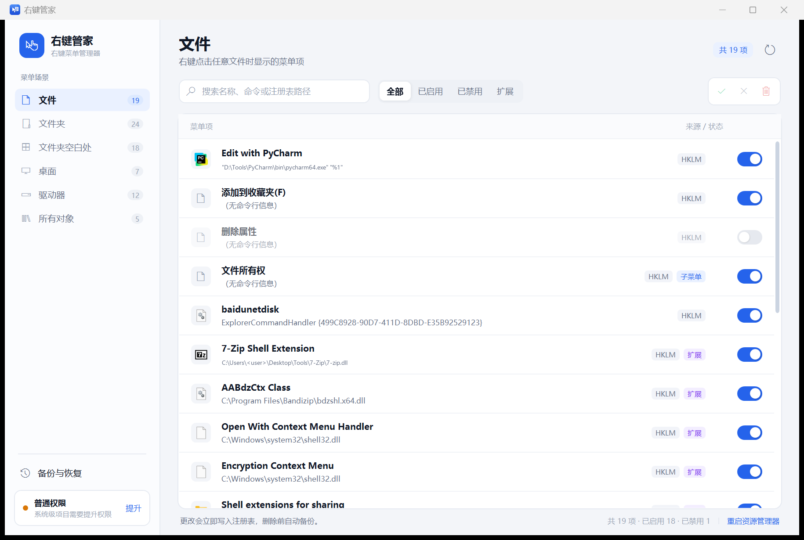
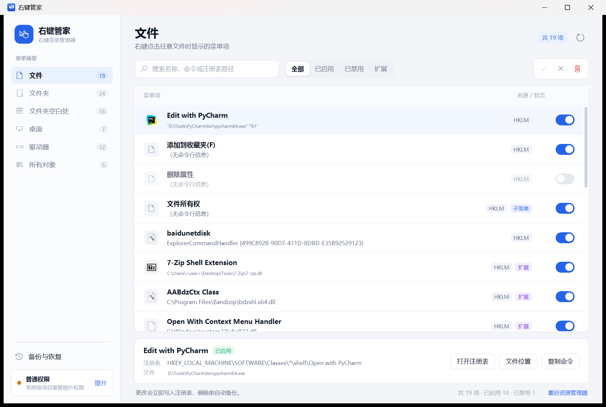
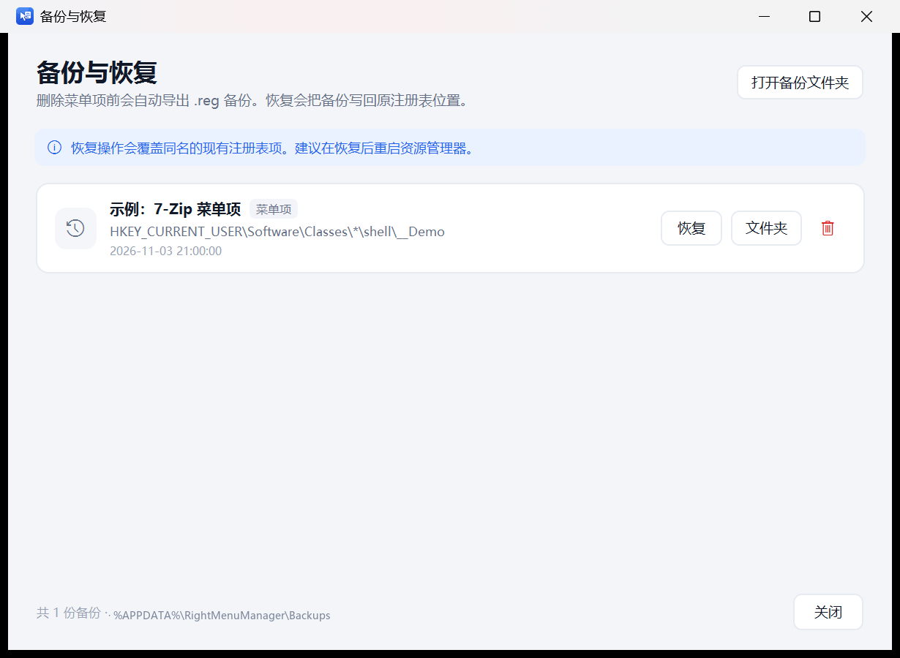

# 右键管家（RightMenuManager）

一个轻量、可还原的 Windows 右键菜单管理器。产品思路参考 [ContextMenuManager](https://github.com/BluePointLilac/ContextMenuManager)，使用 **.NET 8 + WPF** 重写，聚焦于三件事：**看得清楚、改得动、退得回**。



> 截图中的用户名和本地路径已脱敏，菜单项仅用于展示。

## 为什么做这个项目

很多“右键菜单管理”工具为了省事，会直接删除注册表项，或者使用私有标记隐藏菜单。装过多个工具后，注册表状态会越来越乱，出了问题也很难恢复。

右键管家采用 Windows 官方支持的隐藏机制：

- **禁用菜单项**：写入 `LegacyDisable`、`ProgrammaticAccessOnly`、`HideBasedOnVelocityId`，不删除任何项目；
- **禁用 Shell 扩展**：写入 Windows 的 `Shell Extensions\Blocked` 屏蔽列表；
- **删除前自动备份**：先通过 `reg.exe export` 导出完整 `.reg`，再删除，并可通过内置的「备份与恢复」还原；
- **失败自动回滚**：没有管理员权限时，开关会恢复到真实状态，不会出现“界面已关闭、注册表没动”的假象。

## 功能

- **6 个场景**
  - 文件
  - 文件夹
  - 文件夹空白处
  - 桌面
  - 驱动器
  - 所有对象（`AllFilesystemObjects`）
- **两类菜单项**
  - 传统 `shell` 静态菜单项（支持 `MUIVerb`、MUI 资源字符串、命令、图标、Shift 扩展项、子菜单标记）
  - `shellex\ContextMenuHandlers` COM 外壳扩展（解析 CLSID、DLL、显示名称，通过 Blocked 列表启停）
- **来源识别**：`HKCU` / `HKLM` / `HKLM 32 位`，可分别管理
- **搜索与筛选**：多关键词搜索；全部 / 已启用 / 已禁用 / 扩展
- **自动发现新菜单项**：窗口重新激活时检测注册表结构变化，新装软件无需手动刷新；也可按 F5 强制刷新
- **详情与定位**：查看命令行、注册表路径、关联文件；一键打开注册表、文件位置、复制命令
- **安全删除**：自动备份 + 二次确认；系统关键项标记为“受保护”，禁止误改
- **备份管理**：查看历史备份、恢复、打开备份文件夹、删除备份
- **权限处理**：普通权限下修改系统项会提示提升；支持一键以管理员身份重启
- **外壳刷新**：提供「重启资源管理器」入口，Shell 扩展修改后可立即生效





## 安全设计

| 操作 | 实现方式 | 可回滚 |
| --- | --- | --- |
| 禁用静态菜单项 | 写入 `LegacyDisable`、`ProgrammaticAccessOnly`、`HideBasedOnVelocityId` | 删除这些值即可 |
| 禁用 Shell 扩展 | 写入 `HKCU\...\Shell Extensions\Blocked`，管理员模式同步 `HKLM` | 从 Blocked 列表移除 |
| 删除菜单项 | `reg.exe export` 导出 `.reg` → 删除注册表项 | 通过「备份与恢复」导入 |
| 受保护项 | 禁止启用/禁用/删除（如 `open`、`runas`、`print` 等） | — |

- 不对 `TrustedInstaller` 所有的注册表项做所有权夺取；遇到受系统保护的项会提示失败原因。
- 关键操作与错误会写入 `%AppData%\RightMenuManager\Logs\app-*.log`，便于排查。
- 备份保存在 `%AppData%\RightMenuManager\Backups`。

## 联网与隐私

- 程序不包含网络请求、遥测或自动更新，不监听端口。
- 备份和日志只保存在本机 `%AppData%\RightMenuManager`，不会上传。
- 程序不会执行右键菜单项里的命令，只读取并展示注册表信息。

## 环境要求

- Windows 10 / 11（x64 或 x86 系统均可，当前主要在 x64 上验证）
- [.NET 8 Desktop Runtime](https://dotnet.microsoft.com/download/dotnet/8.0)（使用框架依赖发布时）
- 开发需要 .NET 8 SDK

## 构建与运行

```powershell
# 还原 + 编译
dotnet build RightMenuManager.sln -c Release

# 直接运行
dotnet run --project src/RightMenuManager
```

如果系统 PATH 中没有 `dotnet`（例如通过用户目录安装 SDK），可以直接使用完整路径：

```powershell
& "$env:LOCALAPPDATA\Microsoft\dotnet\dotnet.exe" build RightMenuManager.sln -c Release
& "$env:LOCALAPPDATA\Microsoft\dotnet\dotnet.exe" run --project src/RightMenuManager
```

### 发布

框架依赖、单文件：

```powershell
dotnet publish src/RightMenuManager/RightMenuManager.csproj `
  -c Release -r win-x64 --self-contained false `
  -p:PublishSingleFile=true `
  -o publish/win-x64-framework-dependent
```

自包含（目标机器无需安装 .NET 8 Desktop Runtime，体积较大）：

```powershell
dotnet publish src/RightMenuManager/RightMenuManager.csproj `
  -c Release -r win-x64 --self-contained true `
  -p:PublishSingleFile=true `
  -p:IncludeNativeLibrariesForSelfExtract=true `
  -o publish/win-x64-self-contained
```

### 安装包

安装包使用 [Inno Setup 6](https://jrsoftware.org/isinfo.php) 构建，安装时可自选目录：

```powershell
& "$env:LOCALAPPDATA\Programs\Inno Setup 6\ISCC.exe" installer\RightMenuManager.iss
```

产物：`publish/installer/右键管家-安装程序.exe`。安装后会创建开始菜单快捷方式，可选桌面快捷方式；卸载程序为安装目录下的 `unins000.exe`，同时会注册到 Windows 的「已安装的应用」。卸载默认保留 `%AppData%\RightMenuManager` 下的备份和日志，需要彻底清理时可手动删除该目录。

## 使用建议

1. 首次打开会扫描当前用户的右键菜单；之后窗口重新激活时会自动检测新安装的软件，也可以按 F5 手动刷新。
2. 用搜索框快速定位陌生菜单项，例如压缩工具、网盘、IDE。
3. 不确定用途时，优先**禁用**而不是删除；禁用随时可以恢复。
4. 删除前会自动备份，备份可在左下角「备份与恢复」中还原。
5. 修改系统级（HKLM）项目需要管理员权限；点击左下角「提升」重启即可。
6. Shell 扩展是全局开关，修改后建议点击右下角「重启资源管理器」。

> 不建议同时使用多个右键菜单管理工具。不同工具可能采用不同隐藏机制，互相覆盖后会出现“界面显示启用、实际菜单里没有”的情况。

> 程序未进行代码签名，首次运行可能出现 SmartScreen 提示；它会读写注册表，也可能被杀毒软件误报。请确认来源后添加信任。

## 当前限制

- **Windows 11 新版右键菜单**（`IExplorerCommand`、打包应用注册的菜单）尚未纳入管理；当前管理的是传统 `shell` 菜单和 `shellex` 扩展。
- 文件夹场景基于 `Directory`，暂未覆盖特殊文件夹（`Folder`、库、回收站、此电脑等）。
- 暂未包含「发送到」「打开方式」「新建菜单」「WinX」和自定义扩展名场景。
- 暂不支持修改菜单名称、图标、排序和自定义添加菜单项。
- 受系统 ACL 保护的注册表项（TrustedInstaller 等）会修改失败，不会尝试夺取所有权。

## 项目结构

```
RightMenuManager.sln
src/RightMenuManager/
  Models/          # 菜单项、场景、备份条目、筛选枚举
  Services/        # 注册表扫描/修改、备份、图标、外壳、权限、对话框
  ViewModels/      # 主界面状态、筛选、命令
  Views/           # 主窗口、备份窗口、通用消息对话框
  Themes/          # 颜色与控件样式
  Assets/          # 应用图标
tools/             # 图标生成、截图、端到端测试脚本
docs/              # README 截图
```

### 扩展一个新场景

1. 在 `Models/MenuScope.cs` 增加枚举值；
2. 在 `Models/ScopeCatalog.cs` 增加场景定义（标题、描述、图标、注册表基路径）；
3. `ContextMenuScanner` 会自动按场景基路径扫描 `shell` 与 `shellex\ContextMenuHandlers`；
4. 若该场景需要特殊处理（如 `SendTo` 文件夹），在扫描器中加入独立分支。

## 开发验证

项目包含一个端到端脚本，会创建一个临时菜单项，验证：

**搜索 → 禁用 → 启用 → 备份删除 → 恢复**

```powershell
powershell -ExecutionPolicy Bypass -File tools/e2e-test.ps1
```

脚本只操作 `HKCU\Software\Classes\*\shell\__RightMenuManager_Test`，并在结束时清理测试项与备份。请勿在包含重要未保存工作的环境中运行（测试期间会启动和关闭应用窗口）。

重新生成应用图标：

```powershell
pip install pillow
python tools/make_icon.py
```

## 路线图

- 发送到、打开方式、新建菜单、WinX、自定义文件类型
- Windows 11 新版右键菜单
- 批量启用/禁用、拖拽排序
- 自定义添加菜单项（名称、命令、图标、适用范围）
- 多语言与主题
- 更完整的备份差异对比与定时备份
- TrustedInstaller 高级模式（会明确警告并单独开关）

## 免责声明

注册表操作有风险。程序会在删除前自动备份，但仍建议在批量修改前创建系统还原点。作者不对因使用本程序造成的数据丢失或系统异常承担责任。

## License

[MIT](LICENSE)
